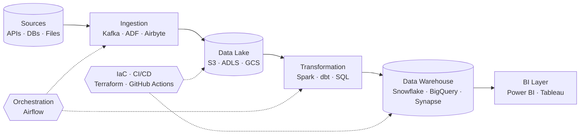

<!-- ============================================================
  GitHub profile README: Ayoub Bakkouri
  Put this file in a PUBLIC repo named exactly: ayoub-bakkouri
  (same as your username). Replace every [PLACEHOLDER].
============================================================= -->

<!-- 3D HEADER -->
<p align="center">
  
</p>

<!-- TYPING ANIMATION -->
<p align="center">
  <a href="https://github.com/ayoub-bakkouri">
    
  </a>
</p>

<p align="center">
  
  
  
</p>

<p align="center">
  <a href="https://www.linkedin.com/in/[YOUR-LINKEDIN]"></a>
  <a href="mailto:[YOUR-EMAIL]"></a>
  <a href="https://[YOUR-PORTFOLIO]"></a>
</p>

---

## 👨‍💻 About Me

```yaml
name:        Ayoub Bakkouri
role:        Cloud Data Engineer & Business Intelligence Developer
location:    Casablanca, Morocco 🇲🇦
focus:       Data pipelines · Data warehousing · Cloud architecture · BI & analytics
currently:   [What you are working on / learning, e.g. Databricks, dbt, Terraform]
languages:   Arabic · French · English
```

I design and operate **cloud-native data platforms** and turn complex datasets into **clear, actionable dashboards**.
From ingestion to visualization, I care about **reliability, performance, and cost-efficiency**.

---

## 🧰 Tech Stack

### ☁️ Cloud
<p>
  
</p>

### 🔄 Data Engineering
<p>
  
</p>

### 📊 Business Intelligence
<p>
  
  
  
  
</p>

### ⚙️ DevOps & Tools
<p>
  
</p>

---

## 🏗️ Data Architecture I Work With



---

## 🚀 Featured Projects

<table>
  <tr>
    <td width="50%" valign="top">
      <h3>📦 [Project 1 name]</h3>
      <p>[One-line description: problem, solution, impact.]</p>
      <p>  </p>
      <a href="https://github.com/ayoub-bakkouri/[repo-1]">🔗 View repository</a>
    </td>
    <td width="50%" valign="top">
      <h3>📊 [Project 2 name]</h3>
      <p>[One-line description: problem, solution, impact.]</p>
      <p> </p>
      <a href="https://github.com/ayoub-bakkouri/[repo-2]">🔗 View repository</a>
    </td>
  </tr>
  <tr>
    <td width="50%" valign="top">
      <h3>☁️ [Project 3 name]</h3>
      <p>[One-line description: problem, solution, impact.]</p>
      <p> </p>
      <a href="https://github.com/ayoub-bakkouri/[repo-3]">🔗 View repository</a>
    </td>
    <td width="50%" valign="top">
      <h3>⚡ [Project 4 name]</h3>
      <p>[One-line description: problem, solution, impact.]</p>
      <p> </p>
      <a href="https://github.com/ayoub-bakkouri/[repo-4]">🔗 View repository</a>
    </td>
  </tr>
</table>

> 💡 Tip: you can also pin repos automatically with
> `https://github-readme-stats.vercel.app/api/pin/?username=ayoub-bakkouri&repo=[repo]&theme=radical`

---

## 📈 GitHub Stats

<p align="center">
  
  
</p>

<p align="center">
  
</p>

---

## 🧊 3D Contribution Graph

<!-- Generated automatically by the GitHub Action in the setup guide below -->
<p align="center">
  
</p>

---

## 🎯 Currently

- 🔭 Working on **[current project]**
- 🌱 Learning **[e.g. Databricks · dbt · Data Mesh]**
- 🏅 Certifications: **[e.g. Azure DP-203 · AWS Data Engineer · PL-300]**
- 💬 Ask me about **cloud data platforms, ETL/ELT, data modeling, Power BI**
- ⚡ Fun fact: **[something personal]**

---

<p align="center">
  
</p>

<p align="center"><i>"Data is only valuable when it drives a decision."</i></p>
